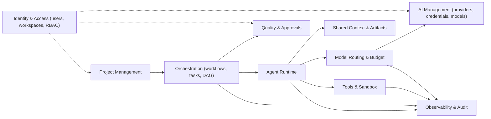

# 01 — Requirements Analysis & Domain Model Summary

## 1. Problem Statement
Users submit a software idea; the platform orchestrates specialized, model-agnostic AI Agents through a verifiable SDLC pipeline (BA → Architecture/DB → Planning → Implementation → Integration → Test → Review → Delivery), sharing knowledge via versioned artifacts (not chat transcripts), executing code only in sandboxes, and enforcing token budgets, quality gates and human approvals.

## 2. Actors
| Actor | Description |
|-------|-------------|
| Owner / Administrator | Manages workspace, providers, credentials, global routing, budgets |
| Project Manager | Creates projects, approves requirements/design, manages members |
| Developer / Reviewer | Reviews artifacts, code, approves gates |
| Viewer | Read-only |
| AI Agents (system actors) | Orchestrator, BA, Architect, Database, Developer, QA, Review (+ extended) |
| AI Providers (external) | OpenAI, Gemini, Anthropic, Ollama, OpenAI-compatible, custom |

## 3. Functional Requirement Groups (traceable to Blueprint §)
| ID | Group | Blueprint § |
|----|-------|-------------|
| FR-PM | Projects, members, requirements, stories, AC, milestones, repositories | 2.1 L2, 13.1–13.2 |
| FR-AI | Providers, credentials, model registry, probing, playground | 3, 4.6, 4.7 |
| FR-CFG | Per-agent model config, 5-level precedence, fixed/adaptive/hybrid | 4 |
| FR-RT | Model Router, fallback state machine, routing audit | 5 |
| FR-AG | Agent registry, immutable versions, skills, handoffs | 6 |
| FR-CTX | Shared Project Context, Context Manager, packages, cache invalidation | 7 |
| FR-WF | Workflow engine, adaptive stages, conditional/parallel, pause/resume | 8 |
| FR-TASK | Task state machine, DAG, leases/heartbeats, bounded retries | 9 |
| FR-BUD | Multi-tier budgets, telemetry, thresholds, exhaustion protocol | 10 |
| FR-TOOL | Tool registry, Tool Executor, sandbox, Git integration | 11 |
| FR-QG | Deterministic-first quality gates with immutable evidence | 12 |
| FR-SEC | RBAC, 7-dim agent permissions, approvals, prompt-injection defense | 16 |
| FR-OBS | Immutable execution traces, redaction, lineage queries | 17 |
| FR-UI | Dashboards and navigation | 15 |

## 4. Non-Functional Requirements
- **Security:** secrets encrypted at rest (AES-256-GCM envelope), never returned/logged; least privilege; sandboxed execution.
- **Reliability:** checkpoint/resume; lease recovery; idempotent POST/PUT (`Idempotency-Key`).
- **Auditability:** every invocation answers the 8 lineage questions (§17).
- **Extensibility:** adapters/registries for providers, tools, agents, runtimes.
- **Deployment:** local-first (single machine), hybrid-ready (split workers later).
- **Quality-first:** budget pressure never silently skips verification.

## 5. Bounded Contexts (Domain Model)

## 6. Core Aggregates
| Aggregate | Root | Key invariants |
|-----------|------|----------------|
| Project | `projects` | members scoped to workspace; one repo per project |
| Provider | `ai_providers` | credentials encrypted; capabilities declared by adapter |
| Model | `ai_models` | unknown metadata stored as `unknown`, never guessed |
| AgentModelConfig | `agent_model_configs` | scoped (global/project/workflow/agent/task), versioned |
| AgentDefinition | `agents` + `agent_versions` | immutable per version |
| Workflow Run | `workflow_runs` | steps follow state machine; checkpointable |
| Task | `tasks` | DAG acyclic; transitions validated; completed only via gate |
| Artifact | `context_items` + `artifact_versions` | approved = immutable; SHA-256 hashed |
| Context Package | `context_packages` | immutable manifest; cache key composite hash |
| Budget | `token_budgets` | hierarchy system→project→workflow→task→invocation |
| Approval | `approval_requests` | only human approvers decide |

## 7. Ambiguities / Conflicts Detected (need decisions — see 09)
1. **Platform core stack** not specified → ADR-001 proposes TypeScript.
2. **Sandbox runtime**: blueprint requires Docker/microVM; Docker not installed on dev host.
3. **Multi-tenancy**: `workspace_id` scoping required, but MVP may be single-workspace.
4. **"Actual cost"**: needs verified pricing; providers rarely expose billing APIs → MVP computes `estimated_cost` only; `actual_cost` null unless provided.
5. **Approval of Task-scope overrides vs hard ceilings**: blueprint states lower scopes cannot override ceilings — enforced as a separate "policy" layer evaluated after precedence resolution.
6. **Vector search** deferred to Phase 9 (structured metadata retrieval first).
