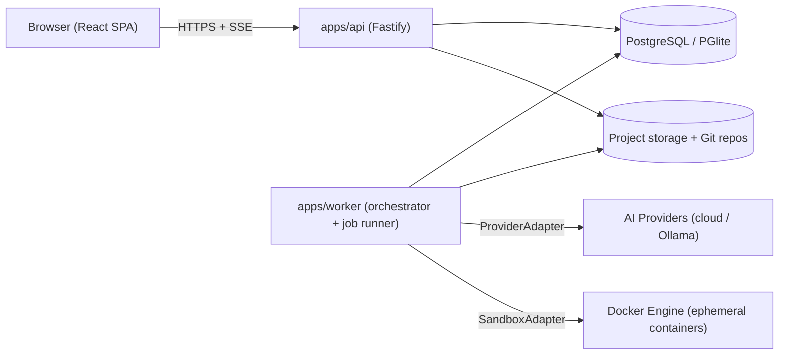
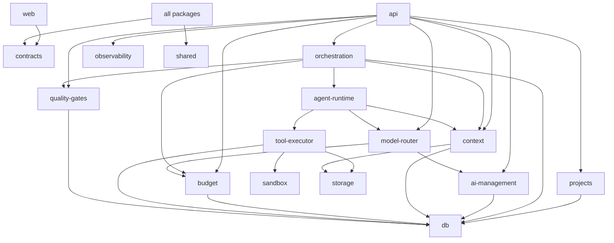
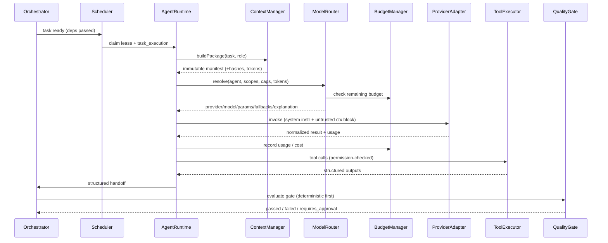

# 03 — System Architecture & Component Diagrams

## 1. Deployment View (local-first, hybrid-ready)

Local mode: `api` and `worker` may run in one process. Hybrid mode: N workers, real Postgres.

## 2. Layer → Package Mapping
| Blueprint Layer | Packages |
|-----------------|----------|
| L1 UI | `apps/web` |
| L2 Project Management | `packages/projects`, `packages/iam` |
| L3 Orchestration | `packages/orchestration` (orchestrator, workflow engine, planner, scheduler, dependency, approvals, checkpoints, events) |
| L4 AI Management | `packages/ai-management` (providers, credentials, registry, configs), `packages/model-router`, `packages/budget`, `packages/context` |
| L5 Agent Runtime | `packages/agent-runtime`, `agent-library/` |
| L6 Tool & Sandbox | `packages/tool-executor`, `packages/sandbox` |
| L7 Data & Observability | `packages/db`, `packages/storage`, `packages/observability` |
| Cross-cutting | `packages/contracts` (schemas/DTOs), `packages/shared` (errors, ids, clock, result) |

## 3. Component Dependency Rules

- Domain packages never import `apps/*`.
- Only `ai-management/adapters` may decrypt credentials (via `SecretStore`).
- Only `tool-executor` may call `sandbox` or spawn processes.
- Only `context` builds context packages.

## 4. Agent Invocation Sequence


## 5. Key State Machines
**Task:** `draft→pending→ready→assigned→running→{waiting_for_input|waiting_for_approval|blocked|failed|completed}`; `failed→ready` (retry, bounded); any non-terminal → `cancelled`. `completed` only reachable through a passed Quality Gate.

**Fallback:** `primary → (timeout|429|5xx|transient|capability_mismatch) → next fallback` ; `(auth_fail|budget_exhausted|no_capable_model|quality_violation|not_allowlisted) → HALT`.

**Budget thresholds:** normal <50% · prune 50–70% · warn 70–85% · reserve-for-verification 85–95% · halt+checkpoint ≥95%.

## 6. Prompt Assembly Contract
```
[SYSTEM]  agent system_instruction (versioned)  + platform safety policy
[TASK]    task spec (objective, AC, output schema)
[UNTRUSTED_CONTEXT id=... hash=...] … artifact content … [/UNTRUSTED_CONTEXT]
```
Untrusted blocks are never interpreted as instructions; tool arguments validated against JSON Schema.
