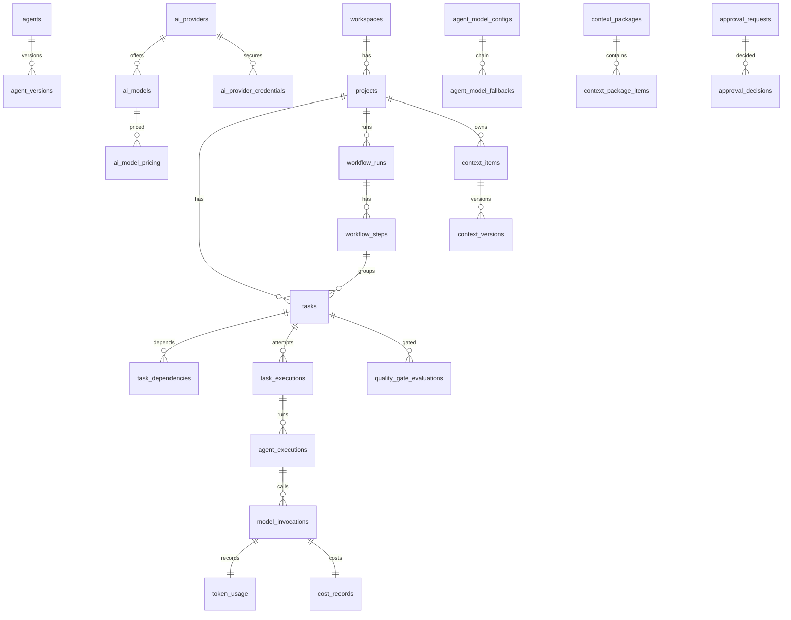

# 04 — Relational Database ERD & Schema Specification

Target: PostgreSQL 16 (PGlite-compatible). Conventions for **every** table unless noted:
`id uuid PK (UUIDv7)`, `created_at timestamptz`, `updated_at timestamptz`, `version int` (optimistic lock) on mutable tables, `workspace_id uuid FK` on tenant-scoped tables. Append-only tables (ledgers, audit, executions, evidence) have no `updated_at`/`version` and reject UPDATE via trigger. No plaintext secret columns anywhere.

## 0. Identity & Access (implied by §14 /auth /users /workspaces)
| Table | Key columns |
|-------|-------------|
| `workspaces` | name, slug UQ, settings jsonb |
| `users` | email UQ, display_name, password_hash (argon2id), status |
| `workspace_members` | workspace_id, user_id, role enum(owner,administrator,project_manager,developer,reviewer,viewer) · UQ(workspace_id,user_id) |
| `sessions` | user_id, token_hash, expires_at, revoked_at |
| `idempotency_keys` | key, user_id, request_hash, response jsonb, expires_at · UQ(key,user_id) |

## 13.1 Project Management
| Table | Key columns |
|-------|-------------|
| `projects` | workspace_id, key UQ/ws, name, description, status, current_stage, storage_path |
| `project_members` | project_id, user_id, role · UQ(project_id,user_id) |
| `project_settings` | project_id UQ, settings jsonb, config_version |
| `repositories` | project_id, kind(git), local_path, default_branch, integration_branch, remote_url |
| `project_environments` | project_id, name, runtime(node/python/php/...), image, config jsonb |

## 13.2 Requirements & Design
| Table | Key columns |
|-------|-------------|
| `requirements` | project_id, code, title, body_artifact_id, status(draft/approved/superseded) |
| `user_stories` | project_id, requirement_id, code, as_a, i_want, so_that, priority, status |
| `acceptance_criteria` | story_id, code, given/when/then text, status, verification_kind(test/manual/review) |
| `architecture_documents` | project_id, artifact_id, status |
| `architecture_decisions` | project_id, adr_number, title, status, artifact_id |
| `database_designs` | project_id, artifact_id, status |
| `api_contracts` | project_id, name, format(openapi/graphql/asyncapi), artifact_id, status |

## 13.3 Agent System
| Table | Key columns |
|-------|-------------|
| `agents` | agent_key UQ, name, role, current_version_id, status(active/disabled/deprecated) |
| `agent_versions` | agent_id, version_no, system_instruction, input_schema jsonb, output_schema jsonb, allowed_tools text[], allowed_file_scopes text[], allowed_actions text[], timeout_seconds, retry_policy jsonb, completion_criteria jsonb, content_hash · UQ(agent_id,version_no) · **immutable** |
| `agent_skills` | skill_key UQ, agent_id NULL, definition jsonb, version_no |
| `agent_tool_permissions` | agent_version_id, tool_key, file_scopes text[], actions text[], max_risk |
| `agent_executions` | task_execution_id, agent_version_id, provider_id, model_id, config_version, context_package_id, status, started_at, completed_at, error_code, retry_count · append-only |
| `agent_handoffs` | project_id, task_id, from_agent, to_agent, status, payload jsonb (schema_version 1.0), payload_hash |

## 13.4 AI Management & Routing
| Table | Key columns |
|-------|-------------|
| `ai_providers` | workspace_id, provider_key UQ/ws, adapter_type(openai_compatible/gemini/anthropic/custom), base_url, enabled, health_status, last_checked_at |
| `ai_provider_credentials` | provider_id, scope(system/workspace), ciphertext bytea, dek_ciphertext bytea, iv, auth_tag, key_version, masked_hint, rotated_at, revoked_at |
| `ai_models` | provider_id, model_key, display_name, availability, context_window NULL, max_output_tokens NULL, quality_tier(economy/standard/high/frontier/unknown), metadata_verified bool, notes · UQ(provider_id,model_key) |
| `ai_model_capabilities` | model_id, capability(tool_calling/structured_output/vision/streaming/reasoning/prompt_caching/embeddings), support(yes/no/unknown) |
| `ai_model_pricing` | model_id, input_per_mtok numeric, output_per_mtok, cached_input_per_mtok NULL, currency, effective_from, source, verified bool |
| `agent_model_configs` | scope(global/project/workflow/agent/task), scope_ref_id, agent_key NULL, mode(fixed/adaptive/hybrid), primary_model_id, params jsonb, limits jsonb, routing_policy jsonb, config_version, active |
| `agent_model_fallbacks` | config_id, position, model_id |
| `agent_model_allowlist` | config_id, model_id *(added: normalizes `allowed_models`)* |
| `model_routing_policies` | workspace_id, name, rules jsonb, hard_ceilings jsonb, version |
| `ai_connection_tests` | provider_id, model_id NULL, result enum(connection_successful,authentication_failed,model_unavailable,rate_limited,timeout,unsupported_capability,unknown_error), latency_ms, diagnostics jsonb (redacted) · append-only |

## 13.5 Workflows & Tasks
| Table | Key columns |
|-------|-------------|
| `workflows` | workspace_id, key, name, current_version_id |
| `workflow_versions` | workflow_id, version_no, definition jsonb (stages, conditions, gates) · immutable |
| `workflow_runs` | project_id, workflow_version_id, status, current_step_id, started_by, paused_reason |
| `workflow_steps` | run_id, stage_key, status, position, gate_result |
| `tasks` | project_id, run_id, step_id, title, objective, input_refs jsonb, expected_output jsonb, acceptance_criteria jsonb, agent_role, allowed_tools text[], token_ceiling, cost_ceiling, timeout_seconds, max_retries, retry_count, complexity, status |
| `task_dependencies` | task_id, depends_on_task_id · UQ · cycle check in app |
| `task_assignments` | task_id, agent_id, assigned_by, assigned_at |
| `task_executions` | task_id, attempt_no, worker_id, status, started_at, ended_at, failure jsonb · append-only |
| `task_leases` | task_id UQ, execution_id, holder, expires_at, heartbeat_at |
| `checkpoints` | run_id, task_id NULL, state jsonb, context_version, git_ref |

## 13.6 Shared Context & Knowledge
| Table | Key columns |
|-------|-------------|
| `context_items` | project_id, path UQ/project, type, owner_role, current_version_id, status |
| `context_versions` | context_item_id, version_no, sha256, size, author_agent/user, approved_at, approved_by · immutable |
| `artifact_versions` | project_id, kind, path, version_no, sha256, storage_uri, produced_by_execution_id |
| `context_packages` | project_id, task_id, agent_role, cache_key, context_version, estimated_tokens, manifest jsonb, invalidated_at |
| `context_package_items` | package_id, context_version_id, relevance |
| `project_memories` | project_id, kind, content, source_ref |
| `knowledge_documents` | workspace_id, project_id NULL, title, artifact_id |

## 13.7 Tools & Sandboxes
| Table | Key columns |
|-------|-------------|
| `tool_registry` | tool_key UQ, description, input_schema, output_schema, required_scopes text[], timeout_seconds, risk, idempotent, redaction_policy jsonb, runtimes text[] |
| `tool_permissions` | subject_type(agent_version/role), subject_id, tool_key, scopes, max_risk |
| `tool_executions` | task_execution_id, tool_key, input jsonb (redacted), exit_code, duration_ms, stdout_uri, stderr_uri, sandbox_session_id · append-only |
| `sandbox_sessions` | project_id, task_id, image, limits jsonb, network_policy, status, started_at, destroyed_at |
| `sandbox_artifacts` | session_id, path, sha256, storage_uri |

## 13.8 Budgets & Cost
| Table | Key columns |
|-------|-------------|
| `token_budgets` | level(system/project/workflow/task/invocation), ref_id, token_limit, cost_limit, currency, consumed_tokens, consumed_cost, thresholds jsonb |
| `model_invocations` | agent_execution_id, provider_id, model_id, provider_request_id, routing_explanation jsonb, status, retry_count, duration_ms · append-only |
| `token_usage` | invocation_id, input, output, cached NULL, reasoning NULL |
| `cost_records` | invocation_id, estimated_cost, actual_cost NULL, currency, pricing_id |

## 13.9 Quality, Approvals, Audit
| Table | Key columns |
|-------|-------------|
| `test_runs` | project_id, task_id, kind(unit/integration/api/e2e), tool, tool_version, command, env_id, git_commit, status, log_uri |
| `test_cases` | test_run_id, name, file |
| `test_results` | test_case_id, status, duration_ms, message |
| `code_reviews` | project_id, task_id, reviewer_agent/user, summary, outcome |
| `issues` | review_id NULL, project_id, severity(critical/major/minor/info), title, status |
| `quality_gate_evaluations` *(added)* | task_id, gate_key, outcome(passed/failed/warning/blocked/requires_approval), evidence jsonb (tool, version, command, env, git tree hash, log uri, ts) · append-only |
| `approval_requests` | project_id, subject_type, subject_id, action, risk, requested_by, status |
| `approval_decisions` | request_id, decided_by (human user only), decision, comment |
| `audit_logs` | workspace_id, actor_type, actor_id, action, target, payload jsonb (redacted), ts · append-only |
| `system_events` | type, aggregate_id, payload, status(pending/dispatched/failed), attempts · outbox |

## Indexes (minimum)
`(project_id, status, created_at)` on tasks, workflow_runs, test_runs · `(task_id, created_at)` on executions/invocations · `(cache_key)` on context_packages · `(status, created_at)` partial on system_events where status='pending' · `(expires_at)` on task_leases.

## ERD (core relationships)

