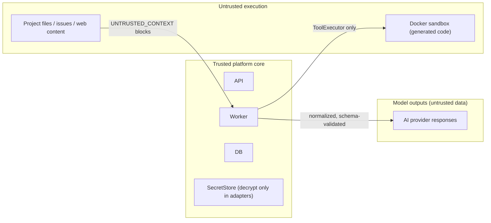

# 07 — Security, Credential Encryption & Sandbox Isolation Model

## 1. Trust Boundaries

## 2. Credential Encryption (ADR-008)
- `PLATFORM_MASTER_KEY` (32 bytes, base64) from env or OS keystore; never in DB/repo. `key_version` supports master-key rotation (re-wrap DEKs).
- Per credential: random 256-bit DEK → AES-256-GCM encrypt secret (random 96-bit IV, auth tag) → DEK wrapped with master key.
- API returns only `masked_hint` (`sk-****abcd`); no endpoint ever returns plaintext after create.
- Decryption only inside `ai-management/adapters` immediately before the HTTP call; plaintext buffers zeroed after use where feasible.
- Redaction layer in logger + audit + error serializer: patterns for API keys, bearer tokens, passwords, `Authorization` headers, known secret values registered at runtime.
- `SecretStore` interface: `LocalEncryptedSecretStore` (MVP), `VaultSecretStore`/`AwsSecretsManagerStore` (future).

## 3. RBAC
| Role | Key permissions |
|------|-----------------|
| Owner | everything incl. workspace deletion, master policies |
| Administrator | providers/credentials/global routing (★approval-gated), members |
| Project Manager | projects, workflows, requirement/design approvals |
| Developer | tasks, artifacts, code review responses |
| Reviewer | reviews, quality gate approvals |
| Viewer | read-only |

Policy engine = pure function `can(subject, action, resource, context) → allow|deny|require_approval`, unit-tested matrix.

## 4. Agent Permission Evaluation (7 dimensions)
`Project × Agent(version) × Task × Tool × FilePathScope(glob) × ActionType × RiskLevel`
Evaluation order: deny-by-default → agent version `allowed_tools`/`allowed_file_scopes`/`allowed_actions` → task `allowed_tools` (intersection) → tool risk ≤ agent max risk → high/critical risk ⇒ `require_approval`. Write ownership per §7.7 (BA→requirements, Architect→architecture, DB→database, Developer with lease→source, QA→test results, Orchestrator→state, humans→approvals).

## 5. Tool Executor Guarantees
- JSON-Schema validation of args; no shell string interpolation (argv arrays only).
- Path jail: resolve realpath, reject `..`, symlinks escaping workspace, absolute paths outside root.
- Timeouts + process-tree kill; output size caps; stdout/stderr stored as artifacts.
- Git guard: block `push --force`, protected-branch deletion, `reset --hard` on shared branches unless approval granted.

## 6. Sandbox Isolation (ADR-009)
Per task ephemeral container:
`--network none` (allowlisted registry proxy only when policy permits) · `--cpus`, `--memory`, `--pids-limit`, disk quota · `--read-only` rootfs + writable `/workspace` (task worktree) + tmpfs `/tmp` · `--user 10001` · `--cap-drop ALL` · `--security-opt no-new-privileges` · no env secrets, no docker socket · destroyed after artifact extraction.
**No host execution fallback** — if Docker is unavailable, sandbox tools report `sandbox_unavailable` and the task becomes `blocked`.

## 7. Prompt-Injection Defense
- System instructions and untrusted content structurally separated; untrusted content wrapped with id+hash markers.
- Model output never mutates permissions/config; only typed tool calls validated against schemas.
- Context Manager enforces read permissions; never includes secrets or other projects' files.
- Handoff payloads are data; schema-validated; cannot carry policy changes.

## 8. Mandatory Human Approvals
Project/repo deletion · production schema changes/high-risk migrations · deployments/publishing · data egress to unverified services · system-level provider/credential/global routing changes · permission escalation · destructive Git · exceeding hard budget limits.
